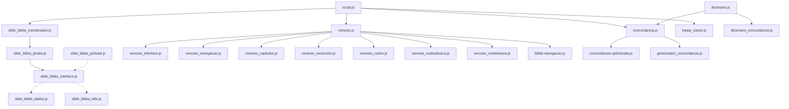

# MAPA COMPLETO DO PROJETO BÍBLIA - ARQUIVOS FONTE

> **Escopo:** Apenas arquivos de código fonte (`.html`, `.css`, `.js`) da raiz do projeto  
> **Excluídos:** `versao/` (1188 arquivos HTML de capítulos), `_backup/`, `*.copy.*`, `.kilo/`, `.mimocode/node_modules/`

---

## 📊 RESUMO ESTATÍSTICO

| Tipo | Quantidade | Tamanho Total |
|------|------------|---------------|
| **HTML** | 5 | 58.8 KB |
| **CSS** | 14 | 579.1 KB |
| **JS** | 50 | 520.5 KB |
| **TOTAL** | **69** | **~1.1 MB** |

---

## 📁 ESTRUTURA DE DIRETÓRIOS

```
E:\biblia\
├── index.html                    # Entry point principal
├── script.js                     # Script global (inicialização)
├── style.css                     # Estilos globais
├── css\                          # 14 arquivos CSS
├── html\                         # 4 páginas HTML auxiliares
└── script\                       # 50 módulos JS
```

---

## 🌐 HTML - PÁGINAS (5 arquivos, 58.8 KB)

| Arquivo | Tamanho | Descrição |
|---------|---------|-----------|
| `index.html` | 3.4 KB | **Página principal** - carregamento inicial, header, navegação |
| `html\versoes.html` | 9.5 KB | Seletor de versões bíblicas (ARC, ACF, NVI, etc.) |
| `html\harpa_cantor.html` | 2.1 KB | Player/hinos da Harpa Cristã |
| `html\menu_dicionarioconcordancia.html` | 9.6 KB | Menu do dicionário/concordância |
| `html\cursos.html` | 34.2 KB | Página de cursos/estudos bíblicos |

---

## 🎨 CSS - ESTILOS (14 arquivos, 579.1 KB)

### Principais (maiores)
| Arquivo | Tamanho | Módulo Relacionado |
|---------|---------|-------------------|
| `css\concordancia.css` | 93.7 KB | Concordância - busca, resultados, índice |
| `css\concordancia copy.css` | 93.5 KB | **Duplicata** - versão anterior |
| `css\versoes.css` | 81.1 KB | **Versões bíblicas** - seletor, cards, grid |
| `css\versoes copy.css` | 81.3 KB | **Duplicata** - versão anterior |
| `css\dicionario.css` | 59.2 KB | Dicionário bíblico - entradas, navegação |
| `css\harpa_cantor.css` | 43.8 KB | Harpa - player, lista hinos, acordes |
| `css\menu_dicionarioconcordancia.css` | 43.6 KB | Menu navegação dicionário/concordância |

### Slide / Apresentação
| Arquivo | Tamanho | Descrição |
|---------|---------|-----------|
| `css\slide_biblia.css` | **39.2 KB** | **Slide Bíblia** - tela cheia, auto-fit, interlinear, cores |
| `css\slide_harpacantor.css` | 30.0 KB | Slide Harpa - projeção hinos |
| `css\modo_leitura.css` | 30.3 KB | Modo leitura contínua (versões) |
| `css\biblia_realizabuscateste.css` | 16.6 KB | Busca realização/teste |

### Auxiliares
| Arquivo | Tamanho | Descrição |
|---------|---------|-----------|
| `css\cursos.css` | 9.2 KB | Página cursos |
| `css\cantor_cristao.css` | 8.2 KB | Cantor cristão (legacy) |
| `css\harpa_crista.css` | 8.5 KB | Harpa cristã (legacy) |
| `style.css` | **30.5 KB** | **Estilos globais** - reset, header, footer, variáveis CSS |

---

## ⚙️ JAVASCRIPT - MÓDULOS (50 arquivos, 520.5 KB)

### 📦 Core / Inicialização (3)
| Arquivo | Tamanho | Responsabilidade |
|---------|---------|------------------|
| `script.js` | 12.8 KB | **Bootstrap global** - carrega módulos, inicializa UI |
| `script\livros_capitulos.js` | 11.4 KB | Dados canônicos: 66 livros, contagem capítulos/versículos |
| `style.css` | 30.5 KB | (CSS global - já listado acima) |

### 📖 Versões Bíblicas - Módulo Principal (10)
| Arquivo | Tamanho | Responsabilidade |
|---------|---------|------------------|
| `script\versoes.js` | **39.0 KB** | **Orquestrador** - carrega versões, navegação, estado |
| `script\versoes_interface.js` | 5.0 KB | UI: renderiza seletor, cards, grid de versões |
| `script\versoes_navegacao.js` | 9.4 KB | Navegação: livro → capítulo → versículo |
| `script\versoes_capitulos.js` | 11.0 KB | Carrega lista de capítulos do livro selecionado |
| `script\versoes_versiculos.js` | 15.4 KB | Renderiza versículos (HTML/JSON), highlights |
| `script\versoes_cache.js` | 6.4 KB | Cache em RAM de capítulos (Map: `versao_livro_cap`) |
| `script\versoes_realizabusca.js` | 29.5 KB | Busca textual: índice invertido, ranking, snippets |
| `script\versoes_modoleitura.js` | 25.3 KB | **Modo leitura contínua** - scroll infinito, auto-load |
| `script\versoes_navegacao_modoleitura.js` | 7.6 KB | Navegação específica do modo leitura |
| `script\biblia-navegacao.js` | 38.9 KB | Navegação geral compartilhada (histórico, URL) |

### 🎬 Slide Bíblia - Apresentação (7) ⭐ **FOCO RECENTE**
| Arquivo | Tamanho | Responsabilidade |
|---------|---------|------------------|
| `script\slide_biblia.js` | **66.3 KB** | **Legacy monolítico** - abre popup, carrega, navega (mantido p/ compat) |
| `script\slide_biblia_interface.js` | **38.9 KB** | **Gera HTML/JS inline do popup** - template string, auto-fit |
| `script\slide_biblia_janela.js` | 11.8 KB | Abre/fecha `window.open()`, valida, injeta HTML |
| `script\slide_biblia_coordenador.js` | 7.0 KB | Listener botão "Slide", captura estado, dispara fluxo |
| `script\slide_biblia_dados.js` | 13.1 KB | Dados estáticos: nomes livros, contagem, ordem canônica |
| `script\slide_biblia_preload.js` | 6.3 KB | Pré-carrega capítulo em `window.versiculoCache` |
| `script\slide_biblia_utils.js` | 9.3 KB | Utilitários: normalização, validação, contagem |

### 🎵 Slide Harpa Cantor (6)
| Arquivo | Tamanho | Responsabilidade |
|---------|---------|------------------|
| `script\slide_harpacantor.js` | 19.6 KB | Orquestrador slide hinos |
| `script\slide_harpacantor_interface.js` | 14.1 KB | Gera HTML popup hinos |
| `script\slide_harpacantor_janela.js` | 4.1 KB | Gerencia janela popup hinos |
| `script\slide_harpacantor_coordenador.js` | 2.9 KB | Listener botão slide harpa |
| `script\slide_harpacantor_dados.js` | 1.6 KB | Dados hinos (títulos, números) |
| `script\slide_harpacantor_utils.js` | 1.5 KB | Utilitários harpa |

### 📚 Concordância / Dicionário (7)
| Arquivo | Tamanho | Responsabilidade |
|---------|---------|------------------|
| `script\concordancia-optimizada.js` | **42.7 KB** | **Busca otimizada** - índice, fuzzy, sugestões |
| `script\gerenciador_concordancia.js` | 29.0 KB | Gerencia estado, histórico, favoritos |
| `script\concordancia.js` | 16.6 KB | Interface principal concordância |
| `script\dicionario.js` | 21.4 KB | Dicionário bíblico - entradas, navegação |
| `script\dicionario_concordancia.js` | 11.1 KB | Ponte dicionário ↔ concordância |
| `script\concordancia-busca-indexada.js` | 4.5 KB | Busca indexada (legacy) |
| `script\gerenciador_concordancia_novo.js` | 5.8 KB | Nova arquitetura (WIP) |

### 🎵 Harpa Cantor / Hinos (2)
| Arquivo | Tamanho | Responsabilidade |
|---------|---------|------------------|
| `script\harpa_cantor.js` | 16.1 KB | Player hinos: áudio, acordes, transposição |
| `script\sobre.js` | 15.2 KB | Modal "Sobre" - créditos, versão, links |

### 🔧 UI Components / Utils (7)
| Arquivo | Tamanho | Responsabilidade |
|---------|---------|------------------|
| `script\dropdown.js` | 11.6 KB | Componente dropdown genérico |
| `script\dropdown_concordancia.js` | 13.2 KB | Dropdown específico concordância |
| `script\menu_dicionarioconcordancia.js` | 18.7 KB | Menu lateral dicionário/concordância |
| `script\marcadagua.js` | 2.5 KB | Marca d'água dinâmica (canvas) |
| `script\biblia_realizabusca.js` | 1.9 KB | Busca realização (legacy) |

### 📜 Versões - Arquivos de Dados/Config (8)
| Arquivo | Tamanho | Descrição |
|---------|---------|-----------|
| `script\original.js` | **23.0 KB** | Config versão **Original** (hebraico/grego, interlinear) |
| `script\arc.js` | 13.3 KB | Config Almeida Revista e Corrigida |
| `script\ara.js` | 10.1 KB | Config Almeida Revista Atualizada |
| `script\acf.js` | 8.0 KB | Config Almeida Corrigida Fiel |
| `script\nvi.js` | 10.7 KB | Config Nova Versão Internacional |
| `script\naa.js` | 10.7 KB | Config Nova Almeida Atualizada |
| `script\ntlh.js` | 10.7 KB | Config Nova Tradução Linguagem de Hoje |
| `script\nvt.js` | 10.6 KB | Config Nova Versão Transformadora |
| `script\kjv.js` | 11.1 KB | Config King James Version |

---

## 🔗 DEPENDÊNCIAS ENTRE MÓDULOS (window.* exports)



### Exports `window.` Principais
| Módulo | Exporta |
|--------|---------|
| `slide_biblia_dados.js` | `livroAcentuadosParaSemAcentos`, `baseLivros`, `contagemVersiculosPorVersao`, `livrosOrdem` |
| `slide_biblia_utils.js` | `normalizarNomeLivro`, `obterNomeAcentuado`, `validarLivro`, `obterContagemVersiculos`, `obterProximoLivro`, `obterLivroAnterior`, `obterTotalCapitulos` |
| `slide_biblia_interface.js` | `gerarHtmlJanelaSlide`, `escreverHtmlNaJanela` |
| `slide_biblia_janela.js` | `abrirJanelaSlide`, `fecharJanelaSlide` |
| `slide_biblia_coordenador.js` | `inicializarSlide` |
| `slide_biblia_preload.js` | sobrescreve `gerarHtmlJanelaSlide` e `abrirJanelaSlide` |
| `livros_capitulos.js` | `livrosBiblia`, `capitulosPorLivro`, `versiculosPorCapitulo` |
| `versoes.js` | `versaoAtual`, `livroAtual`, `capituloAtual`, `carregarVersao()` |
| `concordancia-optimizada.js` | `buscarConcordancia()`, `indiceConcordancia` |
| `harpa_cantor.js` | `tocarHino()`, `pararHino()`, `transporTom()` |

---

## 🎯 ARQUIVOS CRÍTICOS PARA MANUTENÇÃO

| Prioridade | Arquivo | Motivo |
|------------|---------|--------|
| **P0** | `script\slide_biblia_interface.js` | Gera popup - auto-fit, interlinear, cores |
| **P0** | `css\slide_biblia.css` | Estilos slide - clamp, cores hebraico, layout RTL |
| **P0** | `script\slide_biblia.js` | Legacy - ainda usado se coordenador falhar |
| **P1** | `script\versoes.js` | Orquestrador principal versões |
| **P1** | `script\versoes_versiculos.js` | Renderização versículos (HTML/JSON) |
| **P1** | `script\concordancia-optimizada.js` | Busca principal - performance |
| **P1** | `script\original.js` | Config versão original (dados interlinear) |
| **P2** | `script\slide_biblia_janela.js` | Gerencia window.open() |
| **P2** | `script\slide_biblia_preload.js` | Cache antecipado |
| **P2** | `style.css` | Variáveis CSS globais, reset |

---

## 📋 DUPLICATAS / LEGACY PARA LIMPEZA

| Arquivo | Status | Ação Sugerida |
|---------|--------|---------------|
| `css\concordancia copy.css` | Duplicata exata de `concordancia.css` | **Remover** |
| `css\versoes copy.css` | Duplicata exata de `versoes.css` | **Remover** |
| `css\menu_dicionarioconcordancia copy.css` | Duplicata | **Remover** |
| `script\slide_biblia.js` | Legacy monolítico | **Manter** (fallback) mas marcar deprecated |
| `script\biblia_realizabusca.js` | Legacy (1.9 KB) | Verificar uso - pode remover |
| `script\concordancia-busca-indexada.js` | Legacy (4.5 KB) | Substituído por `concordancia-optimizada.js` |
| `script\gerenciador_concordancia_novo.js` | WIP (5.8 KB) | Integrar ou remover |

---

## 📂 DADOS BÍBLICOS (fora do escopo mas relevante)

```
versao\
├── arc\          # 1188 arquivos HTML - capítulos Almeida Revista
├── acf\          # JSON - Almeida Corrigida Fiel
├── ara\          # JSON - Almeida Revista Atualizada
├── nvi\          # JSON - Nova Versão Internacional
├── kjv\          # JSON - King James
├── ntlh\         # JSON - Linguagem de Hoje
├── naa\          # JSON - Nova Almeida
├── nvt\          # JSON - Nova Versão Transformadora
└── original\     # JSON - Hebraico/Grego + interlinear (palavras[])
```

> **Nota:** 1188 arquivos HTML em `versao/arc/` + JSONs nas outras versões. Não incluídos no mapeamento por serem **dados/conteúdo**, não código fonte.

---

## 🔧 COMO ADICIONAR NOVA VERSÃO

1. Criar `script\nova_versao.js` (baseado em `acf.js`)
2. Adicionar pasta `versao\nova_versao\` com JSONs por livro/capítulo
3. Registrar em `versoes.js` → `versoesDisponiveis`
4. Adicionar CSS específico se necessário em `versoes.css`
5. Atualizar `slide_biblia_dados.js` se tiver contagem diferente

---

## 📝 ÚLTIMA ATUALIZAÇÃO

- **Data:** 2026-11-19
- **Foco recente:** Slide Bíblia - auto-fit versão original, cores hebraico, wrapper `.texto-versiculo`
- **Arquivos modificados:** `slide_biblia_interface.js`, `slide_biblia.js`, `slide_biblia.css`